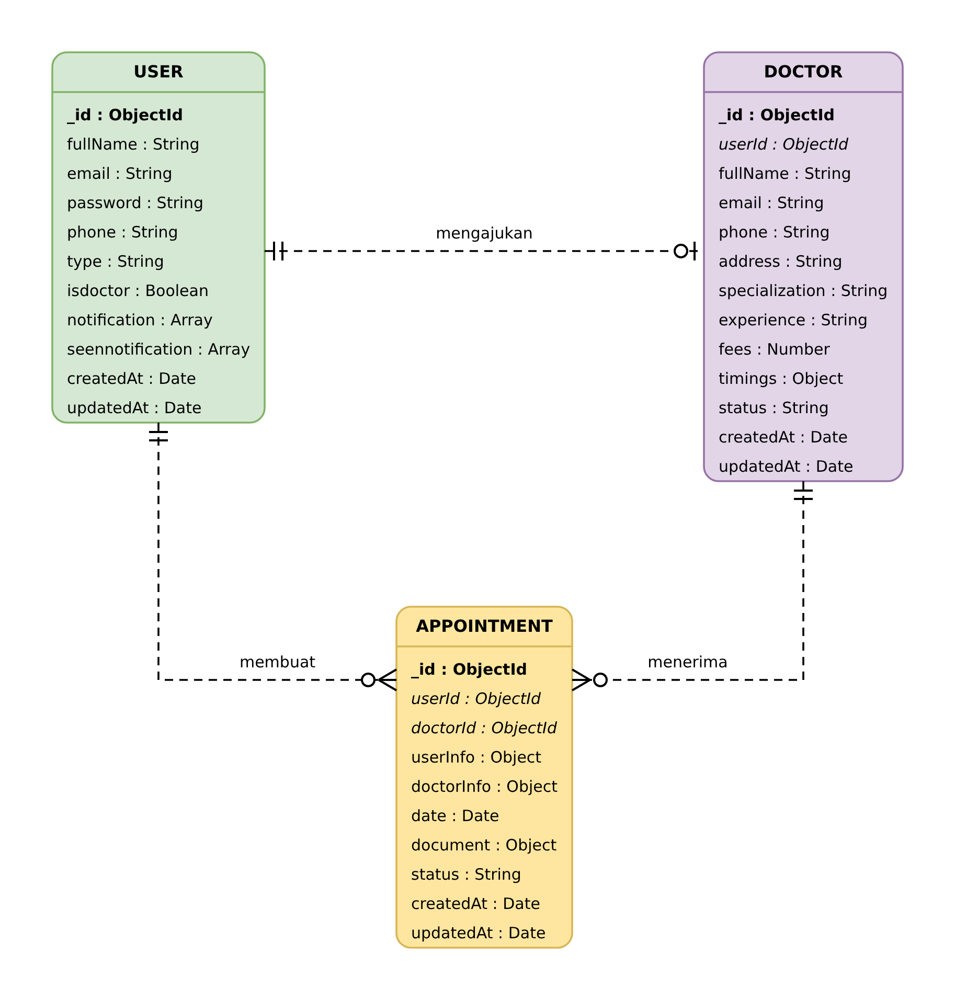

# Book a Doctor App

Aplikasi web pemesanan janji temu dokter berbasis MERN (MongoDB, Express.js, React.js, Node.js). Aplikasi ini mempertemukan **pasien**, **dokter**, dan **admin** dalam satu platform: pasien memesan janji temu, dokter mengelola permintaan yang masuk, dan admin menyetujui pendaftaran dokter.

## Fitur

**Pasien**
- Registrasi dan login (JWT)
- Melihat daftar dokter yang sudah disetujui
- Membuat janji temu dengan memilih tanggal dan jam, serta mengunggah dokumen pendukung (PDF, JPG, JPEG, PNG; maksimal 5 MB)
- Mengajukan diri sebagai dokter
- Membaca, menandai, dan menghapus notifikasi

**Dokter**
- Melihat janji temu yang masuk beserta dokumen pasien
- Menyetujui atau menolak janji temu
- Menerima notifikasi saat ada permintaan baru

**Admin**
- Menyetujui atau menolak pengajuan dokter
- Melihat daftar seluruh pengguna
- Menerima notifikasi saat ada pengajuan dokter baru

**Aturan utama:** hanya dokter berstatus *approved* yang tampil, satu dokter tidak bisa memiliki dua janji aktif pada jam yang sama, dan halaman dibatasi menurut peran (di sisi React dan di sisi server).

## Teknologi

| Lapisan | Teknologi |
| --- | --- |
| Frontend | React 19, Vite, react-router-dom, axios, Bootstrap 5, react-bootstrap |
| Backend | Node.js, Express 5, cors, dotenv, nodemon |
| Keamanan | bcryptjs, jsonwebtoken (JWT) |
| Unggah berkas | multer |
| Database | MongoDB Atlas, Mongoose |

## Struktur Proyek

```
book-a-doctor/
├── client/      # aplikasi React (Vite)
├── server/      # API Express
│   ├── config/        # koneksi database
│   ├── controllers/   # logika bisnis
│   ├── middlewares/   # auth, admin, upload, error handler
│   ├── routes/        # rute API
│   ├── schemas/       # model Mongoose
│   └── uploads/       # dokumen pasien (isinya tidak diunggah ke Git)
└── ERD/         # gambar diagram ER
```

## Diagram ER

Tiga koleksi: `users`, `doctors`, dan `appointments`. Satu user dapat memiliki satu profil dokter, dan baik user maupun dokter dapat memiliki banyak janji temu.



## Cara Menjalankan

**Prasyarat:** Node.js, npm, dan akun MongoDB Atlas (atau MongoDB lokal).

### 1. Backend

```bash
cd server
npm install
```

Buat file `.env` di dalam folder `server`:

```
PORT=8001
JWT_KEY=isi_dengan_kata_acak_yang_panjang
MONGO_URL=isi_dengan_connection_string_mongodb
```

Jalankan server:

```bash
npm start
```

Server berjalan di `http://localhost:8001`.

### 2. Frontend

Buka terminal baru:

```bash
cd client
npm install
npm run dev
```

Buka `http://localhost:5173` di browser.

### 3. Membuat akun admin

Semua akun baru terdaftar sebagai pasien. Untuk membuat admin, daftar seperti biasa, lalu ubah field `type` pada dokumen akun itu di koleksi `users` menjadi `admin` (lewat MongoDB Compass atau Atlas), kemudian login ulang.

## Endpoint API

Semua endpoint berawalan `/api`. Rute terlindungi membutuhkan header `Authorization: Bearer <token>`.

| Metode | Endpoint | Akses |
| --- | --- | --- |
| POST | `/api/user/register` | Publik |
| POST | `/api/user/login` | Publik |
| GET | `/api/user/doctors` | Login |
| POST | `/api/user/apply-doctor` | Login |
| POST | `/api/user/book-appointment` | Login |
| GET | `/api/user/my-appointments` | Login |
| GET | `/api/user/notifications` | Login |
| POST | `/api/user/notifications/read-all` | Login |
| DELETE | `/api/user/notifications/seen` | Login |
| GET | `/api/doctor/appointments` | Dokter |
| POST | `/api/doctor/update-status` | Dokter |
| GET | `/api/admin/doctors` | Admin |
| POST | `/api/admin/update-doctor-status` | Admin |
| GET | `/api/admin/users` | Admin |

## Batasan

- Berkas unggahan disajikan lewat `/uploads` tanpa pemeriksaan login. Untuk produksi, akses berkas perlu dilindungi.
- Belum ada pencarian atau penyaringan dokter, pengingat email atau SMS, dan halaman riwayat janji temu untuk pasien.
